# Flutter: fundamentos, instalación y widgets

---

## Instalación

Se creó un proyecto nuevo con `flutter create` y se corrió en Chrome con `flutter run -d chrome`. Abrió el contador de demo y el botón funcionaba, así que todo quedó bien instalado. `flutter create` deja listo el proyecto con sus carpetas y archivos, y con `-d chrome` se le dice a Flutter que la app se abra en el navegador.

---

## StatelessWidget

Es un widget que solo muestra lo que recibe, no guarda nada que cambie. Al correrlo en Chrome salió el folio en el centro de la pantalla. Al cambiar el folio y guardar no pasó nada, hasta que se presionó `r` en la terminal y ahí sí se actualizó el texto. El folio le llega al widget desde afuera y él nada más lo dibuja, por eso siempre se ve igual mientras no se cambie el dato. La tecla `r` es el hot reload, que actualiza la pantalla con el código nuevo sin reiniciar la app.

---

## StatefulWidget

A diferencia del anterior, este sí guarda algo que puede cambiar, y cuando cambia se vuelve a dibujar. En Chrome salió un texto con el botón **Sumar**, y cada vez que se le da al botón el número sube de 1 en 1. El número se guarda en una variable y se cambia con `setState`, que es lo que avisa a Flutter que hay que volver a dibujar. Si la variable se cambiara sin `setState`, el valor sí cambiaría pero en pantalla no se vería nada.

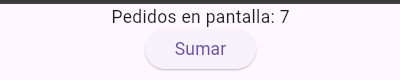

---

## Widgets básicos

### Esqueleto de pantalla

En Chrome salió una barra arriba que dice **Entregas**, el texto *Nuevo pedido*, un cuadro para escribir la distancia en km y abajo el botón **Crear pedido**. En el cuadro se puede escribir cualquier carácter, no solo números. El botón se ve en gris y no se activa aunque se escriba algo, porque en el código está deshabilitado a propósito, con `onPressed: null` en el botón. Todo se acomoda uno debajo del otro, con la barra arriba. Lo de los números solo sirve en el teclado del celular, en Chrome no bloquea nada.

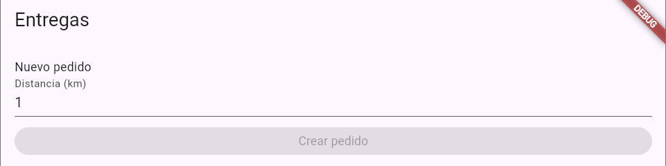

### Lista de pedidos

Salió una barra que dice **Pedidos** y debajo tres filas, cada una con un camión, un folio y el texto *tocar para ver detalle*. A todas se les puede dar clic y, al elegir una, abajo sale un aviso que dice cuál se eligió. La lista crea una fila por cada folio, y cada fila trae su icono, su texto y su flecha. Al darle clic a una fila es cuando sale el aviso de abajo.

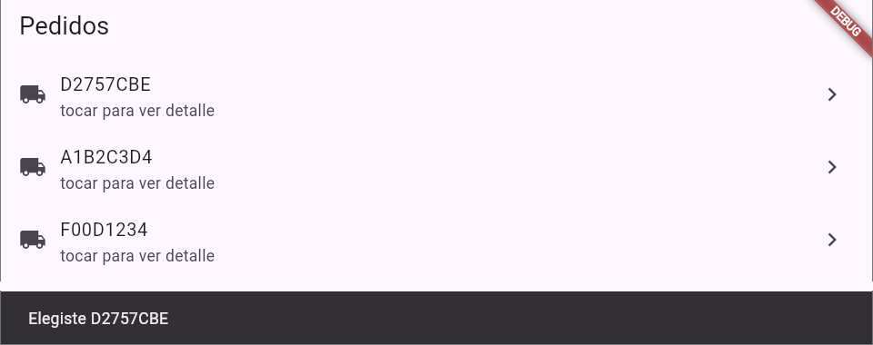

### Row + Expanded

Con `Expanded`, el folio se queda a la izquierda y la palabra **dron** se va hasta la derecha, y cada texto queda en su lugar sin encimarse con el otro. `Row` pone los elementos en una fila, y `Expanded` hace que el folio agarre todo el espacio que sobra, por eso **dron** se va a la derecha.

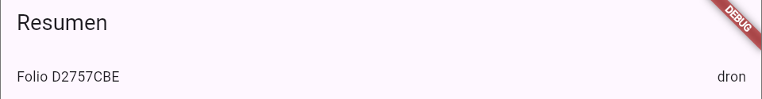

Al quitar el `Expanded`, **dron** quedó pegado justo después del folio. Con un folio muy largo, o al hacer más chica la ventana, el texto se sale de la pantalla y ni se alcanza a ver **dron**. En Chrome aparece una franja amarilla con negro y la terminal avisa del error. Sin `Expanded` cada texto ocupa solo lo que mide, y si ya no caben en la pantalla se salen. La terminal incluso dice cuánto se pasó, en este caso 78 píxeles.

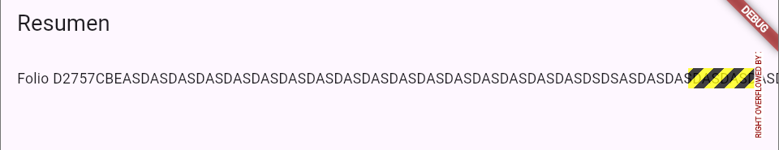

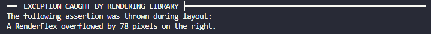

### Switch

Salió una pantalla con el texto **Envío urgente** y a la derecha un interruptor que se puede prender y apagar, y al cambiarlo trae una pequeña animación. El interruptor guarda si está prendido o apagado, y cada vez que se toca se actualiza ese valor y se vuelve a dibujar.

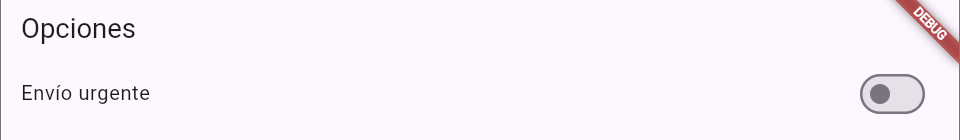

### Dropdown

Es una lista desplegable (como un combobox) que trae tres medios para elegir: motocicleta, dron y camioneta. Al abrirla se ven las tres opciones y se puede escoger la que se quiera. Cada opción tiene un texto que es el que se ve y un valor que es el que se guarda, y lo que se elige se queda guardado.

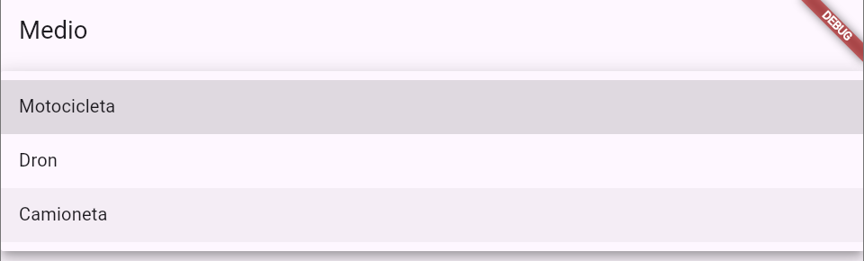

### AlertDialog

Salió un botón **Crear pedido** y, al darle clic, se abre una alerta que pregunta si se quiere mandar la petición, con las opciones **Cancelar** y **Sí**. Si se cancela, no pasa nada y se cierra la alerta. Si se elige **Sí**, abajo aparece un aviso que dice «Aquí iría el HTTP», como ejemplo de cómo se vería. El código abre la alerta y se queda esperando a que se elija una opción. Cada botón cierra la alerta y responde que sí o que no, y solo si fue **Sí** sale el aviso de abajo.

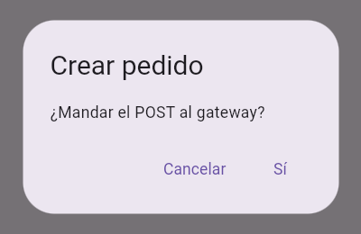

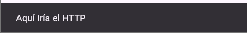

### Navigator

Primero aparece la pantalla con la lista de pedidos. Al darle clic a uno, manda a otra pantalla con su detalle, donde sale el folio en la barra de arriba y un botón **Volver**. Con ese botón se regresa a la pantalla de la lista. Las pantallas funcionan como una pila de hojas: al darle clic a un pedido se pone la pantalla de detalle encima, y con **Volver** se quita para ver otra vez la lista. Al detalle se le manda el folio para que sepa cuál mostrar.

### CircularProgressIndicator

Es un estado de carga que se activa al darle clic al botón **Crear (simulado)**. Mientras carga, aparece un circulito girando y el botón se pone en gris para que no se pueda volver a picar. Pasados unos dos segundos, el circulito desaparece, sale el folio y el botón vuelve a activarse. El widget recuerda si está cargando o no, y el folio que muestra al terminar. Al darle al botón se activa la carga, se esperan dos segundos que simulan lo que tardaría el servidor y luego se muestra el resultado.

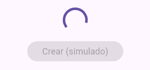

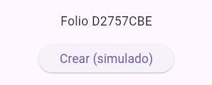

---

## Preguntas cortas

> **1. ¿Qué problema de mantenimiento ataca Flutter al existir web y móvil en el mismo producto?**

Sin Flutter habría que hacer una interfaz distinta para web, Android e iOS, y cada cambio, por ejemplo cuando cambian los datos que manda el backend, habría que repetirlo en cada una, con el riesgo de equivocarse o de que queden diferentes. Con Flutter hay una sola app, así que el cambio se hace una vez.

> **2. ¿Por qué Flutter dibuja sus propios controles en lugar de usar solo los nativos del sistema?**

Porque así el diseño es propio y se ve igual en todas las plataformas, sin depender de cómo dibuje cada sistema sus botones y demás controles. Eso da mejor control sobre cómo se ve la app.

> **3. ¿En qué se diferencian un `StatelessWidget` y un `StatefulWidget`?**

El `StatelessWidget` no guarda estado, solo muestra lo que recibe y se ve igual mientras los datos no cambien. El `StatefulWidget` sí guarda algo que puede cambiar, y cuando cambia con `setState` se vuelve a dibujar esa parte de la pantalla. No recarga toda la página, solo lo que cambió.

> **4. Si `flutter doctor` marca un problema en Android pero Chrome funciona, ¿se puede empezar la clase de widgets igual? ¿Qué no se podría hacer todavía?**

Sí, se puede empezar en Chrome aunque Android marque problema. Lo que no se podría hacer es correr la app en un emulador o celular Android, ni generar el `apk`. Esto sí me pasó al principio, porque Android salía en rojo en `flutter doctor`, y lo arregle terminando de instalar Android Studio con sus herramientas. Mientras tanto la app corrió bien en Chrome.

> **5. ¿Por qué un `Column` sin `Expanded` a veces «desborda» la pantalla cuando se meten muchos hijos?**

Porque `Column` pone los elementos uno debajo del otro, cada uno con el tamaño que ocupa, y si todos juntos miden más que el alto de la pantalla, se salen. No se encima uno con otro, simplemente se pasan de la pantalla.

> **6. ¿Qué widget se usaría para mostrar muchos folios con scroll, y cuál para avisar «pedido creado» sin cambiar de pantalla?**

Para muchos folios con scroll se usa un `ListView`, con un `ListTile` por fila, como en la lista de pedidos. Para avisar «pedido creado» sin cambiar de pantalla se usa un `SnackBar`, que es el aviso que sale abajo.

> **7. ¿En qué se parece el ejemplo de `CircularProgressIndicator` a una llamada real al gateway?**

Se parece en que el proceso es el mismo: se muestra que algo está cargando, se espera una respuesta y luego se muestra el resultado. En el ejemplo la espera de dos segundos es falsa (`Future.delayed`), y con el gateway real se cambia por la llamada al servidor, mientras que el resto queda igual.
