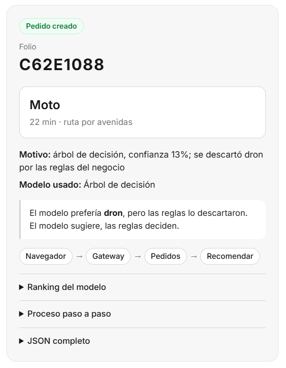
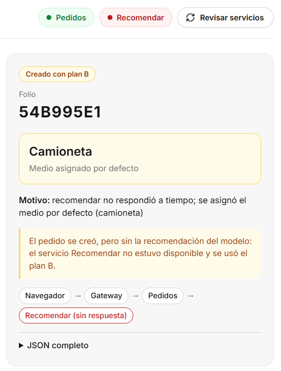
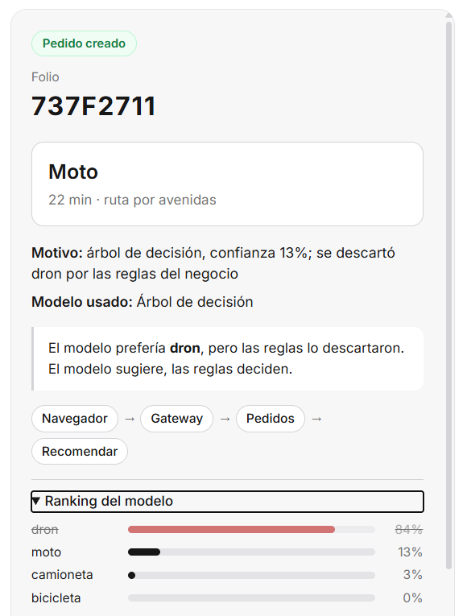
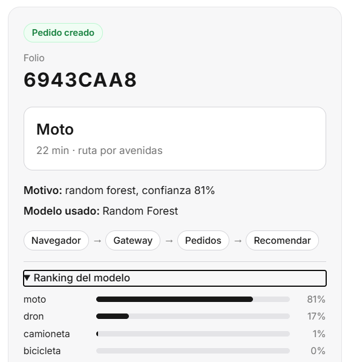
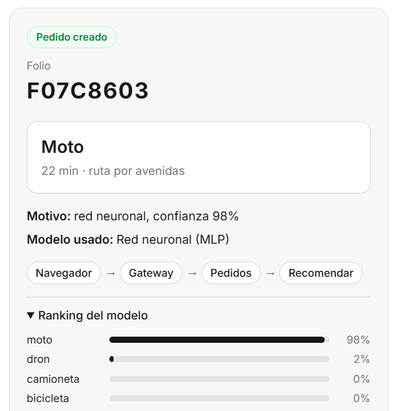

# Actividad — Microservicios con Docker

- **Nombre:** Cesar Enrique Díaz Maldonado
- **Matrícula:** 22121331
- **Equipo:**

## 1. Predicción (hora 3) vs resultado (navegador)

**Predicción.** Se esperaba la moto. El modelo prefiere el dron porque es el de mayor ranking, pero a las 3:00 es de noche y las reglas no dejan que el dron salga a esa hora. Entonces queda el segundo, que es la moto.

**Resultado en el navegador.** Folio `C62E1088`, medio moto, y el motivo dice: árbol de decisión, confianza 13%; se descartó dron por las reglas del negocio.



**Resultado con `curl`.** Sale el mismo medio y el mismo motivo. Solo cambia el folio, `A96CEE00`, porque cada llamada crea un pedido nuevo.

**Comparación.** La predicción se cumplió. La moto tiene solo 13% de confianza y el dron tenía 84%. Queda porque es la siguiente que las reglas dejan usar, no porque el modelo la quiera.

## 2. docker compose ps (qué hay en cada contenedor)

```
NAME                                   IMAGE                                SERVICE      PORTS
microservicios-entregas-gateway-1      nginx:1.27-alpine                    gateway      0.0.0.0:8080->80/tcp
microservicios-entregas-pedidos-1      microservicios-entregas-pedidos      pedidos      8001/tcp
microservicios-entregas-recomendar-1   microservicios-entregas-recomendar   recomendar   8002/tcp
```

Son 3 contenedores con 3 imágenes distintas:

- **gateway:** nginx. Sirve la página y manda cada petición al servicio que le toca.
- **pedidos:** crea el pedido y le pide la recomendación a recomendar. No tiene el modelo.
- **recomendar:** tiene el modelo y las reglas. Solo recomienda.

Solo el gateway publica puerto. El 8001 y el 8002 no tienen flecha, así que solo se ven por dentro. Por eso la única entrada es el gateway.

## 3. Fallo al apagar recomendar (qué mostró la página o el curl)

**Predicción.** Se esperaba que el pedido se creara con el plan B, la camioneta, y que tardara 3 segundos.

**En la página.** No se quedó en blanco. Salió "Creado con plan B" en amarillo, con la camioneta, un aviso de que recomendar no estuvo disponible y el recorrido marcando recomendar sin respuesta.



**Con `curl`.** Folio `BA8DCDE9`, camioneta, `plan_b` en `true`, código **503** y **4 segundos**.

**Comparación.** Se creó con plan B como se esperaba. El 503 solo avisa que recomendar falló, porque el pedido sí se creó. Los 4 segundos son porque, con recomendar apagado, el nombre ya no existe y buscarlo tarda. Si estuviera congelado, el nombre sí existe y pedidos se rendiría a los 3 segundos de espera.

## 4. Réplicas de la etapa 5 vs esto

En la etapa 5 había tres copias de `web`, pero todas salían de la misma imagen y cada una traía todo. Eran el mismo monolito repetido tres veces. Sirve para repartir la carga y para que otra copia siga si una se cae, pero no separa nada.

Aquí cada contenedor es una imagen distinta con un trabajo distinto. Pedidos no puede recomendar porque no tiene el modelo y se lo pide a recomendar por red. Por eso esto sí son microservicios y las réplicas no: las réplicas repiten un mismo servidor, los microservicios son servidores distintos que se hablan entre sí.

## 5. Camino: navegador → … → modelo (red vs import)

```
Navegador --red--> Gateway --red--> Pedidos --red--> Recomendar --import--> modelo
```

Son 3 saltos por red y al final un import. En el monolito había un solo salto por red, del navegador a Django, y todo lo demás era import.

Un import no falla por la red. Una llamada por HTTP sí puede fallar, tardar o no contestar. Por eso pedidos tiene tiempo de espera y plan B.

## 6. Si solo cambia el .joblib, ¿qué reconstruyen?

Solo la imagen de recomendar, porque ahí están los modelos:

```
docker compose build recomendar
docker compose up -d recomendar
```

Pedidos y el gateway no se tocan. En el monolito el `.joblib` está dentro de la única imagen, así que se reconstruye todo y se reinician las tres copias.

## 7. Dos límites de esta práctica antes de producción

1. **Los pedidos se guardan en memoria.** Si pedidos se reinicia, se pierden todos. Faltaría una base de datos.
2. **El gateway deja pasar a cualquiera.** No hay autenticación ni límite de peticiones. Faltaría validar quién entra y limitar cuántas peticiones puede hacer.

## 8. ¿En qué se parece y en qué no el HTML al del monolito Django?

**Se parece** en que es el mismo formulario con los mismos campos y el mismo selector de modelo, y en que manda un JSON con `fetch` y pinta lo que regresa. En los dos la página no decide nada, la regla vive en el backend.

**No se parece** en lo de atrás:

- Django lo entregaba como plantilla. Aquí nginx lo entrega como archivo.
- Antes llamaba a una función dentro de Django. Ahora llama a `/pedidos` del gateway y pasa por tres servicios.
- Antes solo recomendaba. Ahora crea un pedido con folio y muestra el plan B.

El formulario es casi el mismo, pero la arquitectura de atrás no.

## 9. Misma hora 3 con árbol, bosque y red: ¿coincidieron?

**Predicción.** Se esperaba que los tres dieran el mismo medio y que solo cambiaran las probabilidades. También que los tres querrían el dron y que el bosque sería el más seguro.

| Modelo | Medio final | Confianza | Primera opción | ¿Reglas corrigieron? |
|---|---|---|---|---|
| Árbol | moto | 13% | dron | Sí |
| Random Forest | moto | 81% | moto | No |
| Red neuronal | moto | 98% | moto | No |

Árbol de decisión:



Random Forest:



Red neuronal:



**Comparación.** El medio no cambió, los tres dieron moto. El motivo sí, por la confianza y por el camino:

- Solo el árbol quería el dron y las reglas lo descartaron. El bosque y la red ya ponían la moto primero.
- La más segura fue la red neuronal, no el bosque.
- Ser la más segura no es ser la más acertada.
